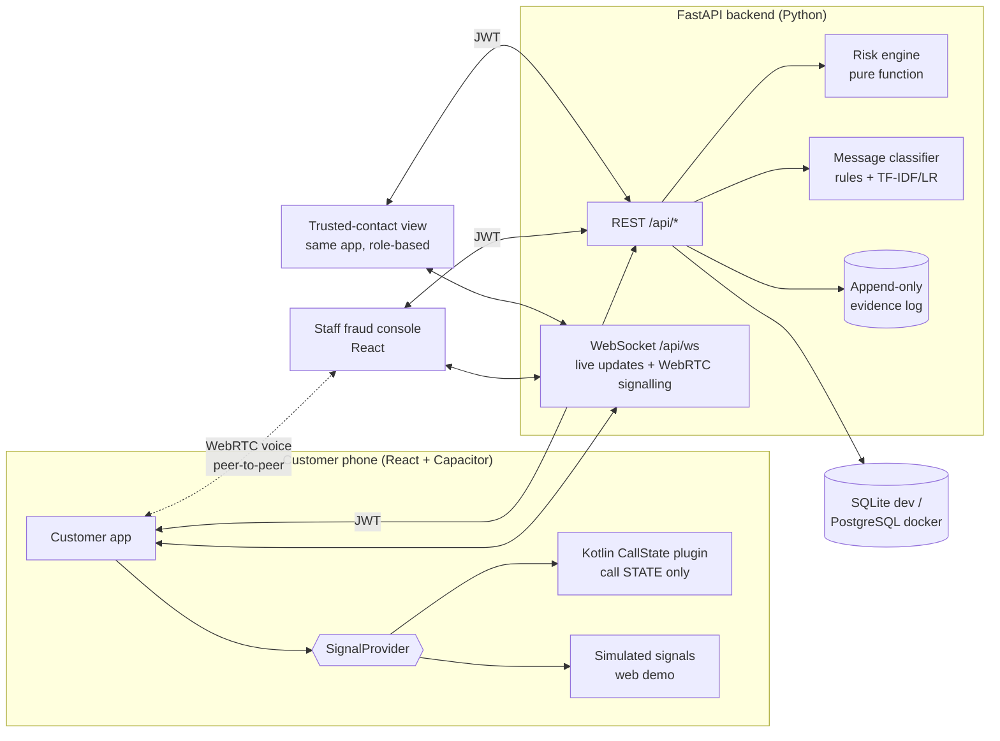

# SafeBank Shield

> **Student proof of concept – synthetic data – not an OCBC product.**
> OCBC IGNITE Innovation Challenge 2026, Problem Statement 3: *Digital Trust – Protecting Customers from AI-Powered Scams.*
> "How might OCBC create a useful moment of friction when acting too quickly could cause customer harm?"

SafeBank Shield is a working end-to-end system. It has three parts, all on one real API and database:

- a **customer app** (web, plus Android via Capacitor)
- a **trusted-contact view**
- an **OCBC-style staff fraud console**

Logins, balances, transfers, risk scoring, pauses, approvals, live updates, voice calls and the evidence log all really work. Only the people and the money are fake.

| | |
|---|---|
| Customer app | http://localhost:5173 (demo launcher at **/demo**) |
| Staff console | http://localhost:5174 |
| API + docs | http://localhost:8000/docs |

---

## What it does

| Feature | What happens |
|---|---|
| **1. Safe-Exit Pause** | The server scores every payment with a pure, tested risk engine. Low risk gets zero friction. Medium risk gets 4 one-per-screen safety questions. High risk gets a calm *"Let's pause this payment"* screen with **Cancel / Save for later / Call SafeBank in-app / Ask my trusted contact**. *Continue anyway* only appears after 30 s, and the server enforces that too. Nothing is ever blocked permanently. |
| **2. Call- and chat-aware trigger** | On Android, a Kotlin Capacitor plugin reads **call state only** (on a call / call ended less than 10 min ago, and screen sharing on Android 15+). On the web, a Demo Controls drawer simulates these signals. A new payee plus any live signal always pauses, even if the customer answers "No" to everything. |
| **3. Official in-app verification** | A real browser-to-browser **WebRTC voice call** with signalling over the app WebSocket. The call shows a *Verified SafeBank Fraud Team* badge and the officer's name. If audio fails it falls back to text chat, and that's logged. **Verify a call** tells the customer whether SafeBank is genuinely calling them right now, using an HMAC-signed call session. |
| **4. Staff triage console** | Live queue sorted by risk then time. The case drawer shows the score breakdown, amount vs usual, signals, answers, call history and an append-only evidence timeline. Actions (each needs a note): Approve, Call customer in-app, Hold & escalate to the Anti-Scam Centre (printable HTML + JSON referral with masked contact details), and Mark as genuine. Keyboard shortcuts: A / C / E / G / Esc. |
| **5. Trusted contact co-sign** | The contact sees only the customer's name, the amount band, whether the payee is new, and why it was flagged. They never see the balance. "OK" lets the payment go; "Stop" sends it to staff review, not a permanent block. Changing a trusted contact takes 24 h, so a scammer holding the phone can't swap them out. Reply window: 2 min in the demo, 24 h in real use. |
| **6. "Is this real?" message checker** | A rule layer (13 plain-language red flags, highlighted inline, tap to see why) plus an ML layer (TF-IDF + logistic regression). A *"Not sure – check through an official channel"* verdict appears when confidence is 0.4–0.6. Customers can report a message to staff. Only redacted text is stored. |
| **Impact panel** | Payments checked, % zero friction, % paused, % cancelled after a pause, false positives, money protected, extra seconds added to genuine payments, trusted-contact response time, message verdict split, and model metrics. |

### Inclusive for every generation
- **Seniors:** Easy Mode (20 px text, 60 px buttons, simpler Home, stronger contrast), **Read aloud** on every warning, question and verdict, 4 text sizes, numbers written in full ("S$8,000"), a Back button on every screen and no gesture-only actions.
- **Young adults:** a zero-friction fast path (Home → payee chip → amount → Review → Send for known payees), dark mode, and youth scams covered: fake jobs, tickets, online shopping, gaming top-ups.
- **Everyone:** English, 中文, Bahasa Melayu and தமிழ் (switch in the header or Settings), WCAG 2.2 AA, a session-timeout warning with "Stay signed in", and respect for `prefers-reduced-motion`.

---

## Architecture



**Monorepo**

```
backend/          FastAPI, SQLAlchemy 2, Alembic, JWT auth, risk engine, classifier, pytest
  app/risk_engine.py      pure scoring function (every rule unit-tested)
  app/routers/            auth, me, transfers, trusted, calls, staff, messages, metrics, demo, ws
  data/messages.csv       444 labelled synthetic messages (generate_messages.py rebuilds it)
customer-app/     React 18 + Vite + TS + Tailwind + i18next + TanStack Query; Capacitor for Android
staff-console/    React 18 fraud console
packages/ui/      design tokens (CSS variables), Tailwind preset, shared components, API client,
                  WebSocket provider, WebRTC engine, locale JSON (en/zh/ms/ta)
android-plugin/   Capacitor plugin in Kotlin (TelephonyCallback / PhoneStateListener)
e2e/              Playwright scenarios + @axe-core/playwright accessibility scans
```

---

## Setup

### Option A – one command with Docker
```bash
docker compose up --build
```
This starts PostgreSQL, the API on :8000 (runs migrations and seeds on start), the customer app on :5173 and the staff console on :5174.
> ⚠️ The Dockerfiles and compose file were written but **not run** on the build machine, because Docker wasn't installed there. Option B is the tested path.

### Option B – without Docker (tested on Windows 11, Python 3.14, Node 26)
```bash
# 1. backend
cd backend
python -m venv .venv
.venv/Scripts/pip install -r requirements.txt        # macOS/Linux: .venv/bin/pip
.venv/Scripts/python -m app.classifier              # trains the model, prints metrics
cd ..
# 2. frontends
npm install
# 3. run everything (API :8000, customer :5173, staff :5174)
npm run dev        # or: make dev
```
The SQLite database is created and seeded on first start. Reset it at any time with `npm run reset`, or the **Reset demo data** button on `/demo`.

Configuration lives in `.env` (copy `.env.example`). Key settings: `DEMO_MODE`, `TRUSTED_TIMEOUT_SECONDS`, `JWT_SECRET`, and optional `TURN_URL` for WebRTC across different networks. Two devices on the same Wi-Fi work without TURN.

---

## Demo accounts (synthetic)

Password for all accounts: **`Demo1234!`** (shown on the login page in DEMO_MODE only).

| Username | Role | Who |
|---|---|---|
| `tan.siewlan` | customer | Mdm Tan Siew Lan, 68, S$42,000, 中文, Easy Mode, trusted contact Daniel (son) |
| `ryan.lim` | customer | Ryan Lim, 21, poly student, S$2,800, English, trusted contact Mrs Lim (mother) |
| `aisha.rahman` | customer | Aisha Rahman, 41, S$15,500, Bahasa Melayu, no trusted contact |
| `daniel.tan` | trusted contact | Mdm Tan's son |
| `mrs.lim` | trusted contact | Ryan's mother |
| `staff.anna` | staff | Anna Koh, SafeBank fraud officer |

Each customer has 6 months of seeded normal history, which gives the unusual-amount check a baseline.

---

## Scenario walkthrough (buttons on `/demo`)

| # | Scenario | Expected result |
|---|---|---|
| 1 | Fake MAS officer – Mdm Tan, on a call, S$8,000 → "MAS Safety Account – Lim K." | Red call banner. Questions → **Pause** (score 7: new payee 2, on call 2, amount 1, unusual 2). **Call SafeBank in-app** → staff console rings → Anna answers → voice connects with the verified badge → Anna escalates to the ASC with a note → customer sees *"Payment held for your safety"*. Balance unchanged. |
| 2 | Genuine urgent bill – Mdm Tan, no call, S$3,200 → "Hospital – NUH Billing" | **Ask** tier (score 5) → all "No" → *Check first* → **Save for later** (1 h) → countdown → *Skip timer (demo)* → **Send now** → sent. Shows the system doesn't block genuine payments. |
| 3 | Everyday payment – Mdm Tan, S$45 → SP Group | Score 0 → *Looks safe* → Send. No friction. |
| 4 | Customer says No to everything – as #1 | Still paused: new payee + live call is an override. |
| 5 | Fake job deposit – Ryan, chatting, S$600 → "HR Onboarding – J. Wong" | Chat banner → Pause (score 6 + override) → **Ask my trusted contact** → Mrs Lim's app updates live (she sees "S$100 – S$1,000", "a NEW payee", the reasons, and nothing else) → she taps **Stop** → Ryan sees *"SafeBank is reviewing"* → appears in the staff queue as *Needs staff review*. |
| 6 | Ticket scam message – Ryan | Concert-ticket sample → **Likely scam** with "PayNow first", "no meetup" and "now" underlined; tap one for the explanation; Report → appears in the staff *Reported messages* tab. |
| 7 | SafeBank server down | Starts a payment with the payment-checking service simulated as down → *"We can't check this payment right now"* → **never sends**. Retry, save on the phone, or cancel. (Stopping the API container or process gives the same result.) |

---

## Tests and results (all run on the build machine)

| Suite | Command | Result |
|---|---|---|
| Backend (pytest) | `npm run test:backend` | **82 passed**. Every risk rule and boundary (S$999.99 / 1,000 / 9,999.99 / 10,000, z = 3.0), the overrides, the 30-s continue-anyway rule, server-side timers, role checks, evidence-log immutability (ORM refuses update/delete), balance changes only on send, trusted-contact privacy and the 24 h change delay, staff notes, classifier metrics, and redaction. |
| Frontend (Vitest) | `npm run test:web` | **12 passed**. Pause screen (heading, reasons, 4 actions, 30-s countdown, "Are you sure?" sheet focusing *Go back*), signal banners, language switch (zh + `<html lang>`), all locale keys present in every language, Easy Mode and dark mode. |
| End to end (Playwright) | `npm run test:e2e` | **18 passed**. Scenarios 1–7, Scenario 3 in 中文, a real network failure, a backend slower than 5 s, invalid input, Verify a call, a staff-initiated call with fallback to text chat, a **real WebRTC voice connection** between the two apps, and **axe scans (WCAG 2.0/2.1/2.2 A+AA) on every main screen in light and dark mode with zero serious or critical violations**. Also: no horizontal scroll at 375 px with Easy Mode and extra-large text. |

First-time e2e setup: `npm run install-browsers -w e2e`. To capture review screenshots: `TOUR=1 npx playwright test tour` (from `e2e/`).

### Message classifier (held-out data)
Trained on `backend/data/messages.csv`: 444 synthetic messages (245 scam, 199 legitimate) covering seniors' and young people's scams, mostly English with some 中文 and Bahasa Melayu.

| Split | Accuracy | Scam precision | Scam recall |
|---|---|---|---|
| Random 25 % hold-out (n = 111) | 1.000 | 1.000 | 1.000 |
| **Harder: whole templates held out** (the model never saw the sentence shape) | **0.901** | **0.873** | **0.969** |

The random split is optimistic because the messages are generated from templates. The grouped split is the more honest number, and it still meets the recall target (≥ 0.9). Real-world performance will be lower; see the limitations below.

---

## Android build (call detection)
> Not built on the development machine (no Android SDK or Java there). The plugin code is complete, but the APK hasn't been tested on a device.

1. Install Android Studio (with SDK 35 and JDK 17).
2. Set `VITE_API_URL=http://<your-laptop-LAN-IP>:8000` in `.env`. Phone and laptop must be on the same Wi-Fi.
3. ```bash
   cd customer-app
   npx cap add android        # first time only
   npm run cap:sync           # builds the web app and runs `npx cap sync android`
   npx cap open android       # opens Android Studio → Run ▶ (or Build → Build APK)
   ```
4. Install the APK. In the app go to **Settings → Call detection → Allow**, which grants `READ_PHONE_STATE` after a plain-language explanation. If you deny it, the app treats signals as unknown, asks the safety questions, and logs `signal_unavailable`.

---

## Privacy: what is and isn't collected

| Collected | Never collected |
|---|---|
| Whether a call is in progress, whether one ended in the last 10 min, and whether the screen is being shared (Android 15+) | Call audio, caller or callee **numbers**, contacts, call logs |
| The customer's own Yes/No answers | Content of WhatsApp, Telegram, SMS or any chat |
| Payment amount, payee, risk score and reasons | Location or device identifiers |
| Checked messages **redacted** (phone numbers and emails masked, links cut to the domain) | Raw pasted message text |
| Evidence events and staff notes (append-only) | |

The trusted contact sees only the name, the amount band, whether the payee is new, and the reasons. The ASC referral masks customer contact details. All data is synthetic.

---

## Requirement checklist (brief → where it's met)

| Brief requirement | Where |
|---|---|
| Build, don't just describe | Full stack, seeded accounts, 112 automated tests |
| Analyse simulated messages / call context | Feature 2 (signals), Feature 6 (checker) |
| Identify warning signals & inconsistencies | Risk-engine reasons, highlighted red flags, unusual-amount z-score |
| Official verification journey | Feature 3 (verified in-app call + Verify a call) |
| Pause-and-verify step | Feature 1 |
| Explain risks, recommend safe actions | Plain-language reasons + safe-action buttons on every warning |
| Customer: check suspicious communication | Feature 6 |
| Customer: understand warning signals | Reasons, flag explanations, first-run "How you're protected" guide |
| Customer: verify via official channel | Feature 3 |
| Employee: triage a reported case | Feature 4 (+ Reported messages tab) |
| System: record evidence & escalation | Append-only `evidence_events`, `staff_actions` audit trail, ASC referral export |
| Back end Python | FastAPI |
| AI: classification / anomaly | TF-IDF + LR classifier; z-score unusual-amount check |
| Security: identity & verification | bcrypt passwords, JWT access + refresh, role guards, rate-limited login, HMAC-signed call sessions |
| Data: synthetic scam & legit scenarios | Seed data + 444-message labelled dataset |
| Out of scope: surveillance | Call state only (see Privacy) |
| Out of scope: blocking without review | Every hold ends in the customer's choice after a delay, or staff review |
| Failure scenarios | Backend down / slow, permission denied, false positive, low ML confidence, trusted-contact timeout, WebRTC failure, invalid input – all implemented and most covered by e2e |
| Measure value | Impact panel (`GET /api/metrics`) |
| Inclusive of all generations | Easy Mode, read aloud, 4 languages, dark mode, fast path, WCAG 2.2 AA scans |

---

## API
Interactive reference at **http://localhost:8000/docs** (OpenAPI). Main groups:
`/api/auth`, `/api/me`, `/api/transfers` (create, answers, send, continue-anyway, save, skip-timer, cancel, ask-trusted), `/api/trusted`, `/api/calls`, `/api/staff` (summary, cases, actions, referral, messages, audit), `/api/messages`, `/api/metrics`, `/api/demo/reset`, `/api/ws`.

---

## Known limitations
- **Synthetic, template-generated message data.** The classifier's real-world accuracy is unknown. A real system needs labelled real scam reports, with consent.
- **Translations** in 中文, Bahasa Melayu and தமிழ் are machine-assisted and marked for native-speaker review (`_meta.review` in each locale file). The demo launcher text is English-only.
- **Read aloud** depends on the device having a voice for the language. Tamil voices are often missing; the app says so instead of failing silently.
- **Docker and the Android APK** were written but not executed on the build machine (see above).
- **WebRTC across different networks** needs a TURN server (`TURN_URL`); on the same Wi-Fi it works with STUN or host candidates.
- In-memory login rate limiting and WebSocket hub: these work for a single server process only.
- "Chatting about this payment" can't be detected on a real phone (by design, we never read chats). It comes from safety question (d), or from the demo toggle.
- Not a security-audited system. Don't reuse the JWT secret or demo passwords anywhere real.

No OCBC logos or trademarks are used. The brand in the app is **SafeBank**.
