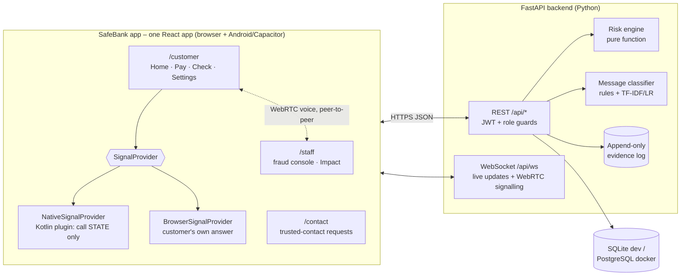

# SafeBank Shield

> **Student proof of concept – synthetic data – not an OCBC product.**
> OCBC IGNITE Innovation Challenge 2026, Problem Statement 3: *Digital Trust – Protecting Customers from AI-Powered Scams.*
> "How might OCBC create a useful moment of friction when acting too quickly could cause customer harm?"

SafeBank Shield is **one real, working app** with all six features inside it. After login, each account sees its own experience:

| Role | Area | Layout |
|---|---|---|
| Customer | `/customer` – Home, Pay, Check a message, Settings | phone |
| Trusted contact | `/contact` – pending requests and history | phone |
| Bank staff | `/staff` – fraud console, reported messages, Impact, audit trail | desktop |

The app runs in the browser and as an Android app (Capacitor), on one FastAPI backend and database. Logins, balances, transfers, risk scoring, holds, approvals, live updates, voice calls and evidence logs all really work. Only the people and the money are fake.

**There are no demo shortcuts:** no scenario buttons, no auto-login, no skip-timer, and no fake signal switches. You test it the way a customer would. See **[TEST_PLAN.md](TEST_PLAN.md)**.

| | |
|---|---|
| App | http://localhost:5173 |
| API + interactive docs | http://localhost:8000/docs |

---

## Test accounts (synthetic)

Password for every account: **`Test1234!`** (listed here only, never shown in the app).

| Username | Role | Details |
|---|---|---|
| `tan.siewlan` | customer | Mdm Tan Siew Lan, 68, S$42,000, 中文, Easy Mode on, trusted contact `daniel.tan` (child) |
| `ryan.lim` | customer | Ryan Lim, 21, polytechnic student, S$2,800, English, trusted contact `mrs.lim` (parent) |
| `aisha.rahman` | customer | Aisha Rahman, 41, working parent, S$15,500, Bahasa Melayu |
| `daniel.tan` | trusted contact | Mdm Tan's son |
| `mrs.lim` | trusted contact | Ryan's mother |
| `staff.anna` | staff | Anna Koh, SafeBank fraud officer |

Seeded payees: known (Tan Wei Ming (son), SP Group, Town Council S&CC, Mrs Lim (mother)) and NEW (MAS Safety Account – Lim K., Hospital – NUH Billing, HR Onboarding – J. Wong, Carousell Seller – ticketsg88). Each customer also has 6 months of normal history, which is the baseline for the unusual-amount check. Customers can **add their own payees** (Pay → Add a new payee); a new payee starts as NEW.

**Reset all data** (command line only, there's no button in the app):
```bash
npm run reset-data          # or: make reset-data   or: cd backend && python -m app.seed --reset
```

---

## Features

| Feature | What happens |
|---|---|
| **1. Safe-Exit Pause** | The server scores every payment with a pure, unit-tested risk engine. Low risk gets zero friction (≤ 3 taps). Medium risk gets 4 one-per-screen safety questions. High risk gets a calm *"Let's pause this payment"* screen with **Cancel / Save for later / Call SafeBank in-app / Ask my trusted contact**. **Save for later** offers the waiting times configured in `.env`; the server only unlocks *Send now* when that time has really passed, and the saved payment survives logout. *Continue anyway* appears after a visible 30-s countdown, and the server enforces the 30 s too. Nothing is ever blocked permanently. |
| **2. Call- and chat-aware trigger** | **Android app:** a Kotlin Capacitor plugin reads call **state only** (on a call / call ended < 10 min ago, plus screen recording on Android 15+). **Browser:** a browser can't see calls, so for any NEW payee the app asks *"Are you on a phone call or chatting with someone about this payment right now?"* (Yes – on a call / Yes – chatting / No). Chats on WhatsApp/Telegram can never be read; they always come from the customer's answer. The server records the signal source (native vs customer answer) in the evidence log. A new payee plus any live signal always pauses. |
| **3. Official in-app verification** | A real browser-to-browser **WebRTC voice call** with signalling over the app WebSocket, showing *Verified SafeBank Fraud Team* and the officer's name. If voice fails it falls back to text chat, and that's logged. **Verify a call** says whether SafeBank is genuinely calling you right now, based on an HMAC-signed call session. |
| **4. Staff triage console** | Live queue sorted by risk then time. The case drawer shows the score breakdown, amount vs usual, signals and their source, answers, call history and an append-only evidence timeline. Actions (each needs a note): Approve, Call customer in-app, Hold & escalate to ASC (printable referral + JSON, contact details masked), Mark as genuine. Keyboard: A / C / E / G / Esc. |
| **5. Trusted contact co-sign** | The contact sees only the name, the amount band, whether the payee is new, and the reasons. **OK** lets the payment be sent; **Stop** sends it to staff review, which isn't a permanent block. Changing or removing a contact waits `CONTACT_CHANGE_COOLING_MINUTES` (24 h by default). If there's no reply within `TRUSTED_CONTACT_TIMEOUT_MINUTES`, the customer can still save the payment for later or call SafeBank. |
| **6. "Is this real?" message checker** | Rule layer (13 plain-language red flags, highlighted inline, tap to explain) plus an ML layer (TF-IDF + logistic regression). *"Not sure – check through an official channel"* appears when confidence is 0.4–0.6. Report → staff *Reported messages*. Only redacted text is stored. |
| **Impact panel** | `/staff/impact`: payments checked, % zero friction, % paused, % cancelled after pause, false positives, money protected, extra seconds on genuine payments, trusted-contact response time, message verdicts, model metrics. |

**Inclusive for every generation:**
- Easy Mode: 20 px text, 60 px buttons, simpler Home.
- Read aloud on every warning, question and verdict.
- 4 text sizes; respects browser zoom (200 % tested at 375 px).
- English / 中文 / Bahasa Melayu / தமிழ்.
- Dark mode.
- WCAG 2.2 AA, checked with axe.
- Session-timeout warning with "Stay signed in".
- Reduced motion respected.

---

## Architecture



```
backend/            FastAPI, SQLAlchemy 2, Alembic, JWT, risk engine, classifier, pytest
  app/risk_engine.py      pure scoring function
  app/seed.py             test accounts; `python -m app.seed --reset`
  data/messages.csv       444 labelled synthetic messages (data/generate_messages.py rebuilds it)
app/                ONE React 18 + Vite + TS + Tailwind + i18next + TanStack Query app, Capacitor for Android
  src/design/             design tokens (CSS variables), Tailwind preset, shared components,
                          API client, WebSocket provider, WebRTC engine, i18n + locales (en/zh/ms/ta)
  src/pages/              customer + trusted-contact screens
  src/staff/              fraud console (lazy-loaded, staff role only)
  src/signals/            SignalProvider: NativeSignalProvider / BrowserSignalProvider
android-plugin/     Capacitor plugin in Kotlin (TelephonyCallback / PhoneStateListener)
e2e/                Playwright tests through the real login screen + axe scans
```

---

## Setup

### Option A – Docker
```bash
docker compose up --build
```
This starts PostgreSQL, the API on :8000 (migrations + seeding on start) and the app on :5173.
> ⚠️ Written but **not run** on the build machine (Docker isn't installed there). Option B is the tested path.

### Option B – without Docker (tested: Windows 11, Python 3.14, Node 26)
```bash
cd backend
python -m venv .venv
.venv/Scripts/pip install -r requirements.txt     # macOS/Linux: .venv/bin/pip
.venv/Scripts/python -m app.classifier           # trains the model, prints metrics
cd ..
npm install
npm run dev            # or: make dev   → API :8000 + app :5173
```
> Windows PowerShell says "running scripts is disabled"? Use `npm.cmd run dev`, or run once: `Set-ExecutionPolicy -Scope CurrentUser RemoteSigned`.

### Configuration (`.env`, copy from `.env.example`)
| Setting | Default | Testing |
|---|---|---|
| `SAVE_FOR_LATER_OPTIONS_MINUTES` | `60,360,1440` | `1,3,5` to test timers in minutes |
| `TRUSTED_CONTACT_TIMEOUT_MINUTES` | `1440` | `2` |
| `CONTACT_CHANGE_COOLING_MINUTES` | `1440` | – |
| `CONTINUE_ANYWAY_SECONDS` | `30` | – |
| `TURN_URL` / `TURN_USERNAME` / `TURN_CREDENTIAL` | empty | for calls across different networks |
| `VITE_API_URL` | same host :8000 | laptop LAN IP for the Android app |

The app reads these values from `GET /api/config` and shows them as they are. There are no timer buttons in the UI.

---

## Tests and results (run on the build machine)

| Suite | Command | Result |
|---|---|---|
| Backend (pytest) | `npm run test:backend` | **90 passed**. Every risk rule and boundary (S$999.99 / 1,000 / 9,999.99 / 10,000, z = 3.0), overrides, the 30-s continue-anyway rule, server-side timers (incl. env-configured 1-minute options), role checks, evidence-log immutability, balance changes only on send, trusted-contact privacy and cooling period, add-payee validation, no demo endpoints, classifier metrics, redaction. |
| App (Vitest) | `npm run test:web` | **15 passed**. Pause screen, signal banners, browser live-call question (asked for new payees, skipped for known ones, merged into signals), language switch, locale completeness, Easy Mode, dark mode. |
| End to end (Playwright) | `npm run test:e2e` | E2E_RESULT |

First-time e2e setup: `npx playwright install chromium` (in `e2e/`). The e2e server uses `SAVE_FOR_LATER_OPTIONS_MINUTES=1,3,5` and `TRUSTED_CONTACT_TIMEOUT_MINUTES=1`, so timer tests really wait about 1 minute.

### Message classifier (held-out data)
444 synthetic messages (245 scam / 199 legitimate), mostly English, some 中文 and Bahasa Melayu.

| Split | Accuracy | Scam precision | Scam recall |
|---|---|---|---|
| Random 25 % hold-out (n = 111) | 1.000 | 1.000 | 1.000 |
| **Whole templates held out** (unseen sentence shapes) | **0.901** | **0.873** | **0.969** |

The random split is optimistic because the data is template-generated. The grouped split is the honest number, and it still meets the recall target of ≥ 0.9.

---

## Android build (call detection)
> Not built on the development machine (no Android SDK/Java there). The plugin code is complete but untested on a device.

1. Install Android Studio (SDK 35, JDK 17).
2. In `.env` set `VITE_API_URL=http://<laptop-LAN-IP>:8000`. The phone must be on the same Wi-Fi.
3. ```bash
   cd app
   npx cap add android        # first time only
   npm run cap:sync           # builds the app and runs `npx cap sync android`
   npx cap open android       # Android Studio → Run ▶ or Build → Build APK
   ```
4. Install the APK and sign in. Then **Settings → Call detection → Allow** to grant `READ_PHONE_STATE`, after the plain-language explanation. If you deny it, the app asks the live-call question instead and logs "signal unavailable".

---

## Privacy: what is and isn't collected
| Collected | Never collected |
|---|---|
| Whether a call is in progress or ended < 10 min ago; screen recording on Android 15+ | Call audio, phone **numbers**, contacts, call logs |
| The customer's own answers (live-call question, safety questions) | Content of WhatsApp, Telegram, SMS or any chat |
| Amount, payee, risk score, reasons, signal source | Location, device identifiers |
| Checked messages, **redacted** (phone numbers and emails masked, links cut to the domain) | Raw pasted message text |
| Evidence events and staff notes (append-only) | |

Trusted contacts see only the name, amount band, payee type and reasons, never the balance or account numbers. ASC referrals mask customer contact details.

---

## Requirement checklist
| Brief requirement | Where |
|---|---|
| Build, don't just describe | One full-stack app, seeded accounts, tests through the real UI |
| Analyse messages / call context | Feature 2, Feature 6 |
| Warning signals & inconsistencies | Risk reasons, highlighted red flags, unusual-amount z-score |
| Official verification journey | Feature 3 |
| Pause-and-verify | Feature 1 |
| Explain risks, recommend safe actions | Reasons + safe-action buttons on every warning |
| Customer: check / understand / verify | Features 6, 1 (+ first-run guide), 3 |
| Employee: triage | Feature 4 |
| System: evidence & escalation | `evidence_events` (append-only), `staff_actions`, ASC referral |
| Python back end, AI | FastAPI; TF-IDF/LR classifier + z-score anomaly |
| Identity & verification | bcrypt, JWT access + refresh, role guards (API + UI), rate-limited login, HMAC-signed calls |
| Synthetic data | Seed accounts + 444-message dataset |
| No surveillance / no permanent blocks | See Privacy; every hold ends in the customer's choice after a delay, or staff review |
| Failure scenarios | Backend down/slow, permission denied, false positive, low confidence, trusted-contact timeout, WebRTC failure, invalid input |
| Measure value | Impact panel |
| All generations | Easy Mode, read aloud, 4 languages, dark mode, fast path |

## API
Interactive reference: **http://localhost:8000/docs**. Groups: `/api/auth`, `/api/me` (account, payees incl. add, activity, trusted contacts, preferences), `/api/transfers` (create, answers, send, continue-anyway, save, cancel, ask-trusted), `/api/trusted`, `/api/calls`, `/api/staff`, `/api/messages`, `/api/metrics`, `/api/config`, `/api/ws`.

## Known limitations
- **Synthetic, template-generated messages.** Real-world classifier accuracy is unknown.
- **Translations** (中文, Bahasa Melayu, தமிழ்) are machine-assisted and flagged for native-speaker review in each locale file. The staff console is English only.
- In the **browser**, call/chat signals depend on the customer answering honestly. That's why a new payee plus "Yes" always pauses, and the 4 safety questions still run.
- **Read aloud** needs a voice for the language on the device (Tamil is often missing). If there isn't one, the app says so.
- **Docker** and the **Android APK** were written but not run on the build machine.
- WebRTC across different networks needs a TURN server.
- Login rate limiting and the WebSocket hub are in-memory, so they work for a single server process only.
- Not security-audited. Don't reuse the JWT secret or test passwords anywhere real.

No OCBC logos or trademarks are used. The brand in the app is **SafeBank**.
